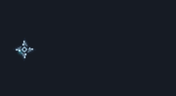

# PixelFX for Unity

[简体中文](README.md) · **English**

Procedural pixel art effects for Unity. The package includes Heavy Cleave, Fireball Throw, and the original Shuriken.

The sample project uses **Unity 2022.3.62f3**, which was used to verify installation, compilation, and editor preview.

## Effect previews

 

| Heavy Cleave | Fireball Throw | Shuriken |
| --- | --- | --- |
|  |  |  |

## Open the demo

Open the repository root in Unity. Choose **Tools > PixelFX > Open Demo**. If prompted, let Unity import and compile the sample, then open the menu again. Enter Play Mode and use the buttons to switch effects. The original **Open Heavy Cleave Demo** also remains available.

For an existing project, use **Window > Package Manager > + > Add package from git URL**, then enter:

```text
https://github.com/wynnforthework/pixelfx-unity.git?path=/Packages/com.pixelfx.unity#v0.1.0
```

For a local checkout, use **Add package from disk** and select `Packages/com.pixelfx.unity/package.json`. Open the demo from the Tools menu or import **PixelFX Demo** from the package's Samples tab.

## Preview and author variants


Open **Tools > PixelFX > Effect Library**. Search the grid by effect name, ID, category or variant name. Select a tile to play, pause, step or scrub its animation in Edit Mode. Tweaks affect the preview draft. **Save As Variant** creates an asset under `Assets`. **Update Variant** writes the draft back to the selected user asset and supports Undo. Distance, secondary target and quality are preview controls.

Click **Copy for AI** in the preview toolbar to copy the selected effect ID, asset path, unsaved settings, and preview state. Paste the text into Codex with your requested changes.

## Play from code

Built-in effects and user variants both use `PixelFxVariant` assets. Select a card and click **Ping Asset** to locate its `.asset` in the Project window, then drag it into an Inspector field on a scene object or prefab. Built-in assets read the C# library defaults. User variants read their saved settings. Add a `PixelFxPlayer` and call `player.Play(effect, context)` for either asset. Playback by effect ID is also supported.

```csharp
using PixelFx;
using UnityEngine;

public sealed class FireballExample : MonoBehaviour
{
    [SerializeField] private PixelFxPlayer player;
    [SerializeField] private PixelFxVariant fireball;

    public void Cast(Vector3 muzzle, Vector3 target, Vector3 splash)
    {
        PixelFxPlayback playback = player.Play(fireball, new PixelFxContext
        {
            Position = transform.position,
            LaunchPoint = muzzle,
            LandingPoint = target,
            Hits = new[] { new PixelFxHit(target), new PixelFxHit(splash, 0.5f) }
        });
        playback.Completed += result => Debug.Log(result.WasStopped ? "Stopped" : "Finished");
    }
}
```

Flight speed is in Unity units per effect second. Settings and target positions are copied when playback starts. Passing no hit list creates one full-strength impact at the landing point. Pass an empty list to omit impacts. `PixelFxPlayer.DefaultQuality` sets the global default and `PixelFxContext.Quality` overrides it per playback. **Full** draws all layers, **Simplified** omits decorative particles, and **Off** keeps timing and completion while allocating no render surfaces. Use `Stop()` on the returned handle to cancel playback.

## Migration progress

On Unity 2022.3.62f3 Windows editor in headless batch mode, Heavy Cleave averaged the following CPU work per 30 FPS effect sample. Texture submission measures the CPU call without a graphics device.

| Quality | Instances | Simulation and raster | Texture submission |
| --- | ---: | ---: | ---: |
| Full | 1 | 3.609 ms | 0.017 ms |
| Full | 10 | 34.530 ms | 0.159 ms |
| Full | 30 | 105.078 ms | 0.504 ms |
| Simplified | 1 | 2.854 ms | 0.012 ms |
| Simplified | 10 | 28.192 ms | 0.155 ms |
| Simplified | 30 | 80.382 ms | 0.422 ms |

The measured playback samples allocated 0 managed bytes after initialization. The editor command **Tools > PixelFX > Measure Quality (1, 10, 30)** repeats this benchmark.

### Upstream checklist

The migration targets `patch-gg/pixelfx@5294518`. **2 / 244** effects passed the upstream visual comparison, Heavy Cleave and Hit Spark. Fireball Throw is a gameplay adaptation, and Shuriken is original. [Migration TODO and resume steps](docs/migration.md#resume-here) · [Hit Spark animation](docs/media/hit-spark.gif)

- [x] Runtime playback, library preview, serialized variants, and quality levels
- [x] Heavy Cleave and original Shuriken
- [x] Fireball Throw with spatial cast, travel, and multiple impacts
- [ ] Refine Fireball Throw against the upstream stage art
- [ ] Port melee and impacts, then projectiles and chained moves
- [ ] Port elemental and status effects, then environment, creatures, and UI
- [ ] Add reusable actor masks, action timing, and front/back sprite layers

## Authoring and license

Find each effect by its ID under `Packages/com.pixelfx.unity/Runtime/`. For example, `moves/fireball-throw` maps to [Effects/moves/fireball-throw](Packages/com.pixelfx.unity/Runtime/Effects/moves/fireball-throw). Each effect keeps its drawing code, particles, dedicated stages, and helpers in its own folder. Shared playback, variants, and the registry live in `Core/`. Painter and texture code live in `Rendering/`.

Runtime and editor code are MIT licensed. Credits for the upstream recipes are included in the package's license and notices. [Authoring guide](docs/authoring.md) · [Codex skill](skills/pixelfx-unity/SKILL.md)
