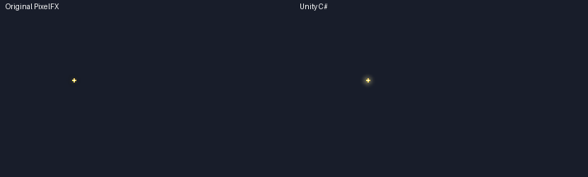
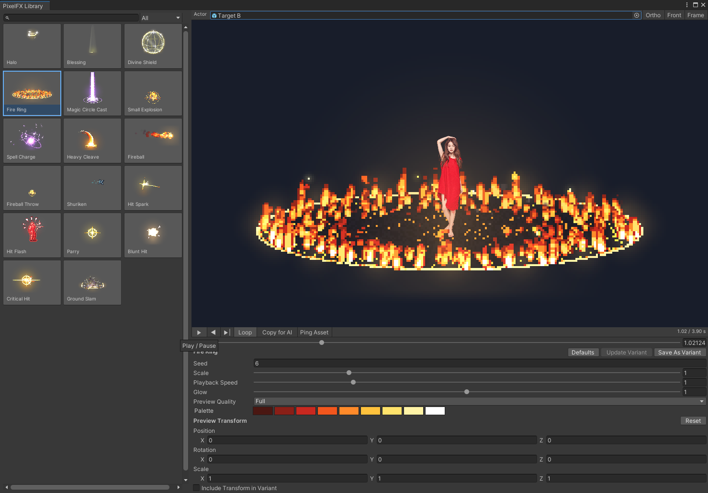

# PixelFX for Unity

[简体中文](README.md) · **English**

Procedural pixel art effects for Unity. The package includes Heavy Cleave, Hit Spark, Hit Flash, Parry, Blunt Hit, Critical Hit, Ground Slam, Fireball, Fireball Throw, Spell Charge, Small Explosion, Magic Circle Cast, Fire Ring, Flame Pillar, Fire Tornado, Divine Shield, Blessing, Halo, Heal, Healing Ring, Holy Pillar, Smite, Sunburst, Feather Burst, Resurrection, and the original Shuriken.

The sample project uses **Unity 2022.3.62f3**, which was used to verify installation, compilation, and editor preview.

## Effect previews

 

| Heavy Cleave | Fireball Throw | Shuriken |
| --- | --- | --- |
|  |  |  |

## Open the demo

Open the repository root in Unity and choose **Tools > PixelFX > Open Demo**. The menu imports the sample and offers **Update Demo Script** when the imported script differs from the package. After Unity compiles the script, open the menu again, enter Play Mode, and use the buttons to switch effects. The original **Open Heavy Cleave Demo** also remains available.

For an existing project, use **Window > Package Manager > + > Add package from git URL**, then enter:

```text
https://github.com/wynnforthework/pixelfx-unity.git?path=/Packages/com.pixelfx.unity#v0.1.0
```

For a local checkout, use **Add package from disk** and select `Packages/com.pixelfx.unity/package.json`. Open the demo from the Tools menu or import **PixelFX Demo** from the package's Samples tab.

## Preview and author variants



Open **Tools > PixelFX > Effect Library**. The dropdown beside the search box offers **All**, **Built-in** for upstream ports, **Variants** for saved variants, and **Originals** for effects authored in this package. Search the selected category by effect name, ID, category or variant name. Select a tile to play, pause, step or scrub its animation in Edit Mode. Tweaks affect the preview draft. **Save As Variant** creates an asset under `Assets`, switches to the **Variants** filter, and selects the new asset. **Update Variant** writes the draft back to the selected user asset and supports Undo. Distance, secondary target and quality are preview controls.

Drag with the left or middle mouse button to pan, scroll to zoom, and drag with the right mouse button or Alt + left mouse button to orbit. **Ortho / Persp** switches projection. **Front** resets the viewing angle and **Frame** centers and fits the actor and effect.

Drag a scene object from the Hierarchy or a prefab from the Project window into **Actor**. The preview scene uses a copy and supports sprite renderers, static and skinned meshes, and Spine SkeletonRenderer objects through the project's existing spine-unity runtime. Choose **Caster** or **Target** for Fireball Throw. The character holds a static pose while the timeline controls the effect. Hit Flash recolors the silhouette of a readable sprite and keeps its impact accents on other renderers.

Use **Preview Transform** in the bottom settings panel to edit the effect's position, rotation and per-axis scale. Built-in effects start at the scene origin with the actor as a visual reference. Use **Reset** to restore zero position and rotation and a scale of `(1, 1, 1)`. Use **Frame** to fit the placed effect and actor.

Enable **Include Transform in Variant** before choosing **Save As Variant** or **Update Variant** to store the placement in that asset. Selecting the variant loads its saved placement. `PixelFxPlayer.Play(variant, context)` applies it relative to the playback anchor and direction. Clearing the checkbox and updating removes the saved placement. Fireball Throw transforms the full visual path around the cast origin and still uses the supplied distance for timing. Placement moves Hit Flash's impact accents while its silhouette stays aligned with the actor.

Click **Copy for AI** in the preview toolbar to copy the selected effect ID, asset path, unsaved settings, and preview state. Paste the text into Codex with your requested changes.

## Play from code

Built-in effects and user variants both use `PixelFxVariant` assets. Select a card and click **Ping Asset** to locate its `.asset` in the Project window, then drag it into an Inspector field on a scene object or prefab. Built-in assets read the C# library defaults. User variants read their saved settings. Add a `PixelFxPlayer` and call `player.Play(effect, context)` for either asset. Playback by effect ID is also supported.

```csharp
using PixelFx;
using UnityEngine;

public sealed class FireballExample : MonoBehaviour
{
    [SerializeField] private PixelFxPlayer player;
    [SerializeField] private PixelFxVariant fireball;

    public void Cast(Vector3 muzzle, Vector3 target, Vector3 splash)
    {
        PixelFxPlayback playback = player.Play(fireball, new PixelFxContext
        {
            Position = transform.position,
            LaunchPoint = muzzle,
            LandingPoint = target,
            Hits = new[] { new PixelFxHit(target), new PixelFxHit(splash, 0.5f) }
        });
        playback.Completed += result => Debug.Log(result.WasStopped ? "Stopped" : "Finished");
    }
}
```

Flight speed is in Unity units per effect second. Settings and target positions are copied when playback starts. Passing no hit list creates one full-strength impact at the landing point. Pass an empty list to omit impacts. `PixelFxPlayer.DefaultQuality` sets the global default and `PixelFxContext.Quality` overrides it per playback. **Full** draws all layers, **Simplified** omits decorative particles, and **Off** keeps timing and completion while allocating no render surfaces. Use `Stop()` on the returned handle to cancel playback.

### Actor-relative playback

Open **Tools > PixelFX > Open Demo**, enter Play Mode, and click **Layered Fireball**. The far arc passes behind caster A, the near arc passes in front, and the explosion follows target B's hit anchor in front of B.

Click **Ground Slam** in the same demo to see an impact at the actor's feet. Bind with `new PixelFxActorBinding(actor, PixelFxLayer.Middle, follow: false)` to snapshot the foot position, draw the cracks, dust column and far arc behind the actor, and draw the near arc and rocks in front.

Click **Hit Flash** to see the actor flash white and red with an outline. Bind the hit actor with `new PixelFxActorBinding(actor, PixelFxLayer.Upper, chestAnchor)`. The optional chest anchor places the impact accents. The silhouette follows the actor's current sprite and scale. Enable **Read/Write** on the sprite texture to draw the silhouette. The impact accents still play when the mask is unavailable. The Effect Library uses a built-in stand-in when **Actor** is empty.

Bind a character's `SpriteRenderer` with `PixelFxActorBinding`. Use `PixelFxContext.Binding` for a one-shot, `CastBinding` for the cast and each `PixelFxHit.Binding` for its impact. `Lower` defaults to the feet and draws behind the actor. `Middle` defaults to the body center and uses the effect's authored back and front passes. `Upper` defaults to the head and draws in front of the actor. Supply an anchor `Transform` to place a foreground impact at the body. Bindings follow the actor by default. Set `follow: false` to use the position at playback start. See the [authoring guide](docs/authoring.md#actor-relative-effect-layers).

## Migration progress

On Unity 2022.3.62f3 Windows editor in headless batch mode, Heavy Cleave averaged the following CPU work per 30 FPS effect sample. Texture submission measures the CPU call without a graphics device.

| Quality | Instances | Simulation and raster | Texture submission |
| --- | ---: | ---: | ---: |
| Full | 1 | 3.609 ms | 0.017 ms |
| Full | 10 | 34.530 ms | 0.159 ms |
| Full | 30 | 105.078 ms | 0.504 ms |
| Simplified | 1 | 2.854 ms | 0.012 ms |
| Simplified | 10 | 28.192 ms | 0.155 ms |
| Simplified | 30 | 80.382 ms | 0.422 ms |

The measured playback samples allocated 0 managed bytes after initialization. The editor command **Tools > PixelFX > Measure Quality (1, 10, 30)** repeats this benchmark.

### Upstream checklist

The migration targets `patch-gg/pixelfx@5294518`. Heavy Cleave, Hit Spark, Hit Flash, Parry, Blunt Hit, Critical Hit, Ground Slam, Spell Charge, Fireball, Small Explosion, Fireball Throw, Magic Circle Cast, Fire Ring, Flame Pillar, Fire Tornado, Divine Shield, Blessing, Halo, Heal, Healing Ring, Holy Pillar, Smite, Sunburst, Feather Burst, and Resurrection passed the upstream visual comparison (**25 / 244**). Shuriken is original. [Migration TODO and resume steps](docs/migration.md#resume-here) · [Hit Spark animation](docs/media/hit-spark.gif) · [Hit Flash animation](docs/media/hit-flash.gif) · [Parry animation](docs/media/parry.gif) · [Blunt Hit animation](docs/media/blunt-hit.gif) · [Critical Hit animation](docs/media/crit-hit.gif) · [Ground Slam animation](docs/media/ground-slam.gif) · [Spell Charge animation](docs/media/spell-charge.gif) · [Fireball animation](docs/media/fireball.gif) · [Small Explosion animation](docs/media/small-explosion.gif) · [Magic Circle Cast animation](docs/media/magic-circle-cast.gif) · [Fire Ring animation](docs/media/fire-ring.gif) · [Flame Pillar animation](docs/media/flame-pillar.gif) · [Fire Tornado animation](docs/media/fire-tornado.gif) · [Divine Shield animation](docs/media/divine-shield.gif) · [Blessing animation](docs/media/blessing.gif) · [Halo animation](docs/media/halo.gif) · [Heal animation](docs/media/heal.gif) · [Healing Ring animation](docs/media/healing-ring.gif) · [Holy Pillar animation](docs/media/holy-pillar.gif) · [Smite animation](docs/media/smite.gif) · [Sunburst animation](docs/media/sunburst.gif) · [Feather Burst animation](docs/media/feather-burst.gif) · [Resurrection animation](docs/media/resurrection.gif)

- [x] Runtime playback, library preview, serialized variants, and quality levels
- [x] Heavy Cleave and original Shuriken
- [x] Fireball Throw with spatial cast, travel, and multiple impacts
- [x] Reuse the upstream charge, projectile, and blast in Fireball Throw and compare all three stages
- [ ] Port melee and impacts, then projectiles and chained moves
- [ ] Port elemental and status effects, then environment, creatures, and UI
- [x] Support actor-relative Lower, Middle and Upper playback
- [x] Add reusable actor silhouette sampling, recolor and outline
- [ ] Add reusable action timing

## Authoring and license

Find each effect by its ID under `Packages/com.pixelfx.unity/Runtime/`. For example, `moves/fireball-throw` maps to [Effects/moves/fireball-throw](Packages/com.pixelfx.unity/Runtime/Effects/moves/fireball-throw). Each effect keeps its drawing code, particles, dedicated stages, and helpers in its own folder. Shared playback, variants, and the registry live in `Core/`. Painter and texture code live in `Rendering/`.

Runtime and editor code are MIT licensed. Credits for the upstream recipes are included in the package's license and notices. [Authoring guide](docs/authoring.md) · [Codex skill](skills/pixelfx-unity/SKILL.md)
