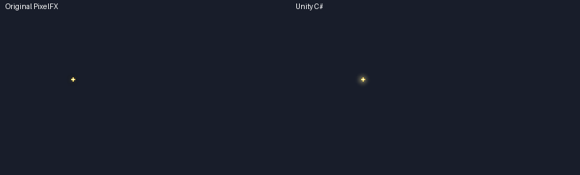
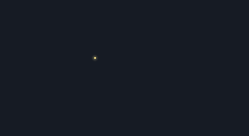
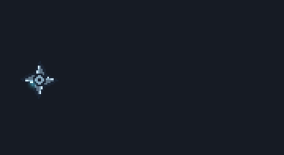
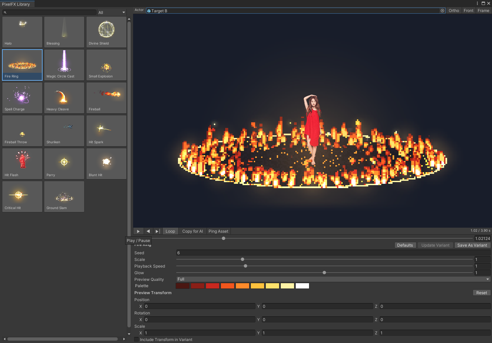

# PixelFX for Unity

**简体中文** · [English](README.en.md)

Unity 程序化像素特效包，内置 Heavy Cleave（重劈）、Hit Spark（命中火花）、Hit Flash（受击闪白）、Parry（招架）、Blunt Hit（钝击）、Critical Hit（暴击）、Ground Slam（震地）、Fireball Throw（火球投掷）和原创 Shuriken（手里剑）。

样例工程使用 **Unity 2022.3.62f3**，安装、编译和编辑器预览均在此版本验证。

## 特效预览

 


| Heavy Cleave（重劈） | Fireball Throw（火球投掷） | Shuriken（手里剑） |
| --- | --- | --- |
|  |  |  |

## 安装与运行样例

克隆仓库后，用 Unity 打开仓库根目录，选择 **Tools > PixelFX > Open Demo**。菜单会导入样例，并在已导入的脚本与包内版本不同时提供 **Update Demo Script**。等 Unity 编译完成后再打开菜单，进入 Play Mode 即可用按钮切换特效。也可以通过 **Open Heavy Cleave Demo** 打开原有的重劈样例。

在已有的 Unity 项目中，打开 **Window > Package Manager > + > Add package from git URL**，输入以下地址。

```text
https://github.com/wynnforthework/pixelfx-unity.git?path=/Packages/com.pixelfx.unity#v0.1.0
```

从本地克隆的仓库安装时，选择 **Add package from disk**，并选中 `Packages/com.pixelfx.unity/package.json`。安装后可从 Tools 菜单打开样例，也可在该包的 **Samples** 标签页导入 **PixelFX Demo**。

## 预览与保存变体



打开 **Tools > PixelFX > Effect Library**。可以按特效名称、ID、类别或变体名称搜索网格。选中特效后，可在编辑模式下播放、暂停、逐帧查看或拖动时间轴。参数修改会即时应用到预览草稿。点击 **Save As Variant** 可在 `Assets` 下创建变体资产，点击 **Update Variant** 可将草稿写回当前选中的用户变体，并支持撤销。目标距离、次要目标和质量档可用于预览不同场景。

在预览区用左键或中键拖动平移，滚轮缩放，右键或 Alt + 左键拖动旋转视角。**Ortho / Persp** 切换正交与透视，**Front** 恢复正视角，**Frame** 居中并适配角色和特效。

把 Hierarchy 里的角色或 Project 里的 Prefab 拖到 **Actor** 槽。预览场景使用角色副本，支持 SpriteRenderer、普通或蒙皮网格，以及通过项目已有 spine-unity 运行库加载的 Spine SkeletonRenderer。火球可以将角色设为 **Caster** 或 **Target**。角色以静态姿势显示，时间轴控制特效。Hit Flash 的轮廓着色使用可读的 SpriteRenderer，其他角色可以一起查看冲击火花和闪光。

在底部参数面板的 **Preview Transform** 调整特效的位置、旋转和各轴缩放倍率。每个特效从场景零点开始，角色作为摆放参照。点 **Reset** 恢复零位置、零旋转和 `(1, 1, 1)` 缩放，点 **Frame** 可以把摆放后的特效和角色重新纳入画面。火球的整条路径随预览变换，Hit Flash 的描边和闪白贴住角色，冲击线和光效可独立摆放。预览变换属于编辑器视图，变体只保存特效参数。

在预览播放条点击 **Copy for AI**，可复制当前特效 ID、资产路径、未保存的参数和预览设置。把复制的文本贴到 Codex，再说明想怎么改。

## 在代码中播放特效

内置特效和用户变体都可以作为 `PixelFxVariant` 资产使用。选中卡片后点 **Ping Asset**，在 Project 窗口定位对应的 `.asset`，再拖到场景或 Prefab 的 Inspector 字段。内置资产读取 C# 注册表中的默认参数，变体资产读取保存的参数。添加 `PixelFxPlayer` 后，两者都用 `player.Play(effect, context)`。也支持用特效 ID 播放。

```csharp
using PixelFx;
using UnityEngine;

public sealed class FireballExample : MonoBehaviour
{
    [SerializeField] private PixelFxPlayer player;
    [SerializeField] private PixelFxVariant fireball;

    public void Cast(Vector3 muzzle, Vector3 target, Vector3 splash)
    {
        PixelFxPlayback playback = player.Play(fireball, new PixelFxContext
        {
            Position = transform.position,
            LaunchPoint = muzzle,
            LandingPoint = target,
            Hits = new[] { new PixelFxHit(target), new PixelFxHit(splash, 0.5f) }
        });
        playback.Completed += result => Debug.Log(result.WasStopped ? "Stopped" : "Finished");
    }
}
```

飞行速度以每特效秒移动的 Unity 单位数计。播放开始时会复制参数和目标位置。省略命中列表时，会在落点播放一次全强度爆炸。传入空列表可跳过爆炸。`PixelFxPlayer.DefaultQuality` 设置全局默认质量，`PixelFxContext.Quality` 可覆盖单次播放的质量。**Full** 绘制所有图层，**Simplified** 省略装饰粒子，**Off** 保留阶段时序与播放完成行为，同时跳过渲染资源分配。调用播放句柄的 `Stop()` 可中止播放。

### 角色分层播放

在 **Tools > PixelFX > Open Demo** 中进入 Play Mode，点击 **Layered Fireball**。施法环的远弧被 A 挡住，近弧盖住 A，爆炸跟随 B 的命中点并显示在 B 前面。

同一面板的 **Ground Slam** 在角色脚下播放冲击。使用 `new PixelFxActorBinding(actor, PixelFxLayer.Middle, follow: false)` 可在脚底固定落点，让地裂、尘柱和远弧在角色身后绘制，近弧和碎石在身前绘制。

点击 **Hit Flash** 查看角色的白闪、红闪和描边。用 `new PixelFxActorBinding(actor, PixelFxLayer.Upper, chestAnchor)` 绑定受击者，可选的 `chestAnchor` 定位冲击线。轮廓贴合角色当前的精灵与尺寸，精灵纹理需启用 **Read/Write**。无可用遮罩时仍播放冲击火花和闪光。Effect Library 的 **Actor** 槽为空时，使用内置测试角色预览。

通过 `PixelFxActorBinding` 绑定一个角色的 `SpriteRenderer`。单段效果使用 `PixelFxContext.Binding`，施法使用 `CastBinding`，每次命中使用各自的 `PixelFxHit.Binding`。`Lower` 默认锚定脚底并在角色后方，`Middle` 默认锚定身体中心并使用效果提供的前后两道绘制，`Upper` 默认锚定头顶并在角色前方。锚点可通过 `Transform` 覆盖，例如把前景爆炸放在身体中心。位置默认跟随角色，设置 `follow: false` 可使用播放开始时的位置。详见[制作规范](docs/authoring.md#actor-relative-effect-layers)。

## 移植进度

移植基准为 `patch-gg/pixelfx@5294518`。已通过上游画面对照验收的特效为 **7 / 244**，包括 Heavy Cleave、Hit Spark、Hit Flash、Parry、Blunt Hit、Critical Hit 和 Ground Slam。Fireball Throw 已完成玩法适配，原版画面仍在还原中。Shuriken 为原创。[移植 TODO 与续接步骤](docs/migration.md#resume-here) · [Hit Spark 动图](docs/media/hit-spark.gif) · [Hit Flash 动图](docs/media/hit-flash.gif) · [Parry 动图](docs/media/parry.gif) · [Blunt Hit 动图](docs/media/blunt-hit.gif) · [Critical Hit 动图](docs/media/crit-hit.gif) · [Ground Slam 动图](docs/media/ground-slam.gif)

- [x] 运行时播放、特效库预览、变体持久化和质量档
- [x] 移植 Heavy Cleave，制作原创 Shuriken
- [x] 实现 Fireball Throw 的施法、按距离飞行与多目标命中
- [ ] 对照上游画面，完善 Fireball Throw 各阶段的视觉表现
- [ ] 移植近战和命中特效，再移植投射物和组合动作
- [ ] 移植元素和状态特效，再移植环境、生物和 UI 特效
- [x] 支持相对角色的下、中、上三层播放
- [x] 添加可复用的角色轮廓取样、着色和描边
- [ ] 添加可复用的动作时序

## 性能数据

在 Windows 上使用 Unity 2022.3.62f3 无图形批处理模式测试 Heavy Cleave。下表为特效以 30 FPS 采样时，每次采样的平均 CPU 耗时。纹理提交列记录无图形设备时提交调用的 CPU 耗时。

| 质量档 | 实例数 | 模拟与光栅化 | 纹理提交 |
| --- | ---: | ---: | ---: |
| Full | 1 | 3.609 ms | 0.017 ms |
| Full | 10 | 34.530 ms | 0.159 ms |
| Full | 30 | 105.078 ms | 0.504 ms |
| Simplified | 1 | 2.854 ms | 0.012 ms |
| Simplified | 10 | 28.192 ms | 0.155 ms |
| Simplified | 30 | 80.382 ms | 0.422 ms |

初始化后的采样阶段，托管内存分配为 0 字节。可通过 **Tools > PixelFX > Measure Quality (1, 10, 30)** 复测。

## 制作规范与许可

在 `Packages/com.pixelfx.unity/Runtime/` 下按特效 ID 找实现。例如 `moves/fireball-throw` 对应 [Effects/moves/fireball-throw](Packages/com.pixelfx.unity/Runtime/Effects/moves/fireball-throw)。每个特效的绘制代码、粒子、专用阶段和辅助代码集中在自己的目录。共用的播放、变体和注册表位于 `Core/`，画笔和纹理处理位于 `Rendering/`。

运行时和编辑器代码采用 MIT 许可。包内的许可和署名文件记录了上游特效代码的归属。[特效制作规范](docs/authoring.md) · [Codex 技能](skills/pixelfx-unity/SKILL.md)
